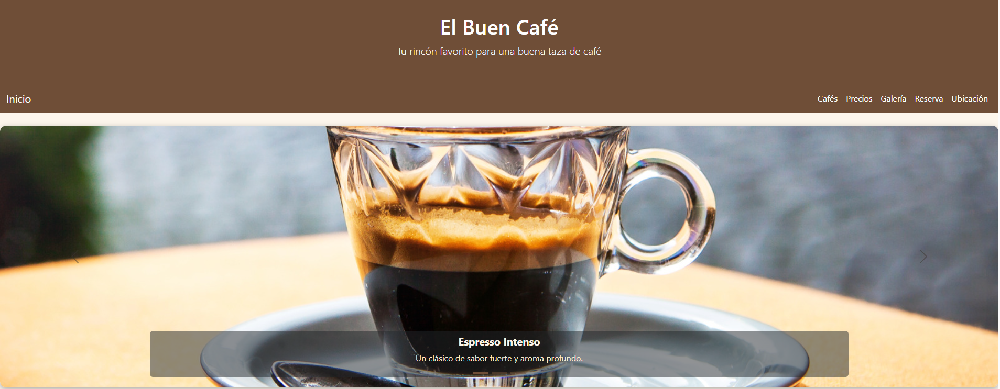
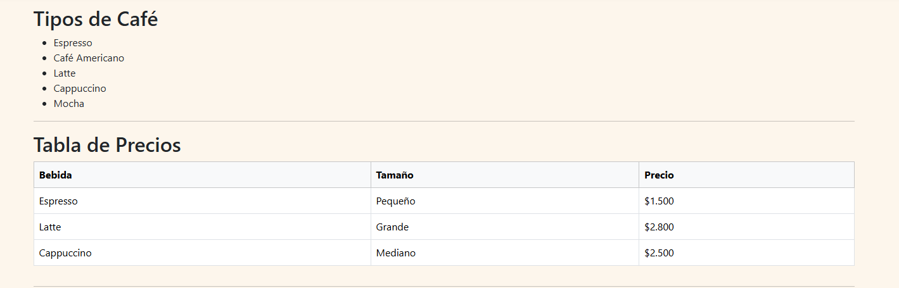
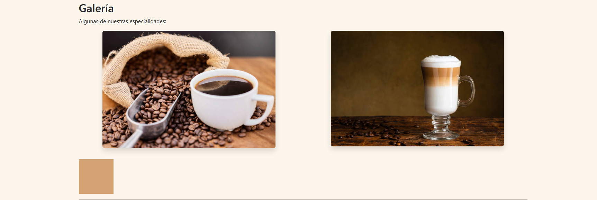
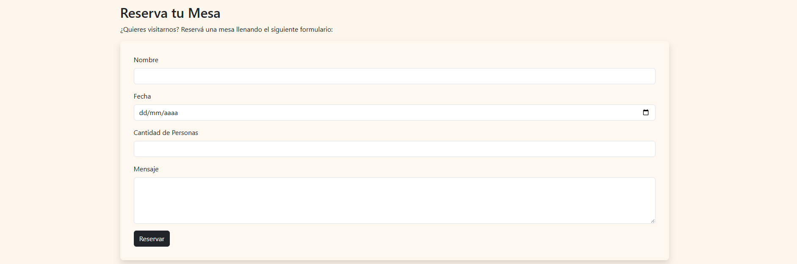
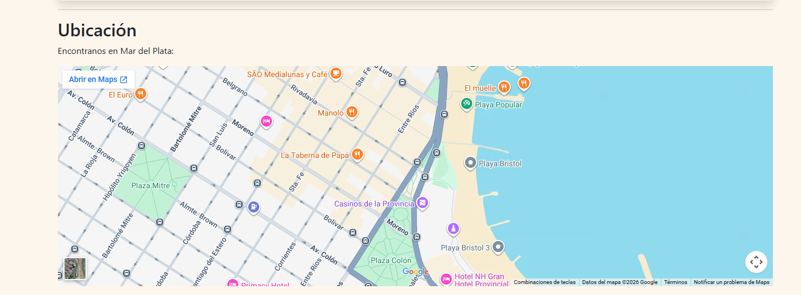

# ☕ El Buen Café

Sitio web de una cafetería de Mar del Plata, hecho con HTML, CSS y Bootstrap.

## Funcionalidades

- Carrusel de productos
- Tabla de precios
- Galería de imágenes
- Formulario de reserva de mesa (con FormSubmit)
- Mapa de ubicación con Google Maps
- Diseño adaptable a celulares

## Tecnologías

- HTML5
- CSS3
- Bootstrap 5
- JavaScript

## Capturas

## Autor

Agustín Pedrozo